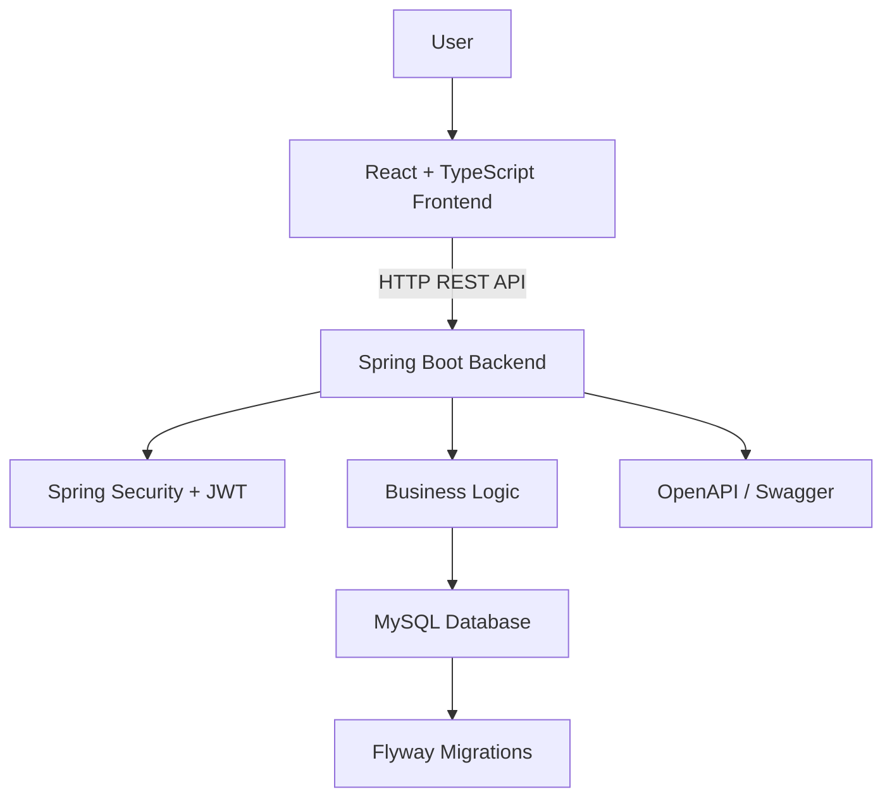

# IncidentIQ — IT Incident Management Platform

A full-stack IT incident management application designed to help teams report, track, assign, and resolve technical incidents through a centralized interface.

Built with **Java 21, Spring Boot, React, TypeScript, MySQL, JWT Authentication, and Docker Compose**, IncidentIQ demonstrates modern full-stack development, REST API design, database management, and containerized deployment.

<p align="center">

  **IncidentIQ | Manage incidents. Improve resolution.**

</p>

---

## Overview

IncidentIQ provides a centralized platform for managing IT support incidents throughout their lifecycle. It is designed as a portfolio project demonstrating practical software engineering concepts, including layered backend architecture, secure API access, relational database persistence, and a modern web frontend.

**GitHub Repository:** https://github.com/Mohammedkhalandar/IncidentIQ

## Technology Stack

| Layer | Technologies |
|---|---|
| Backend | Java 21, Spring Boot 3.4.5 |
| Frontend | React, TypeScript, Vite |
| Database | MySQL 8.4 |
| Authentication | Spring Security, JWT |
| Database migrations | Flyway |
| API documentation | OpenAPI, Swagger UI |
| Containerization | Docker, Docker Compose |
| Build tools | Maven, npm |

## Features

### Incident Management
- Create and view IT incidents.
- Track incident status and priority.
- Assign incidents to team members.
- Update incident details and follow the resolution workflow.
- Maintain incident history for supported actions.

### Authentication and Security
- JWT-based authentication.
- Protected API endpoints.
- Role-aware access control.
- Secure password hashing through the backend authentication implementation.

### Dashboard and User Experience
- Centralized incident management interface.
- Incident status and priority visibility.
- User and team information.
- React and TypeScript frontend architecture.

### Developer Experience
- RESTful backend APIs.
- Interactive Swagger API documentation.
- Versioned database schema management using Flyway.
- Docker Compose-based local environment.
- Persistent MySQL storage.

> Features should be considered implemented only where supported by the current application code. Advanced SLA tracking, notifications, analytics, and other planned capabilities should be documented separately until implemented and tested.

## Architecture



### Project Structure

```text
IncidentIQ/
├── backend/
│   ├── src/
│   │   ├── main/
│   │   │   ├── java/
│   │   │   │   └── com/incidentiq/
│   │   │   └── resources/
│   │   └── test/
│   ├── Dockerfile
│   └── pom.xml
├── frontend/
│   ├── src/
│   ├── public/
│   ├── package.json
│   └── Dockerfile
├── docker-compose.yml
├── .gitignore
└── README.md
```

The exact directory contents may evolve as the application develops.

## Prerequisites

Install the following tools:

- [Git](https://git-scm.com/downloads)
- [Docker Desktop](https://www.docker.com/products/docker-desktop/)
- [Java 21](https://adoptium.net/) and Maven if running the backend outside Docker.
- [Node.js LTS](https://nodejs.org/) if running the frontend outside Docker.

Docker Desktop is the simplest way to run the full application locally.

## Run with Docker Compose

### 1. Clone the repository

```bash
git clone https://github.com/Mohammedkhalandar/IncidentIQ.git
cd IncidentIQ
```

### 2. Start Docker Desktop

Make sure Docker Desktop is running.

Verify the installation:

```bash
docker --version
docker compose version
```

### 3. Start the application

```bash
docker compose up --build -d
```

Check the running containers:

```bash
docker compose ps
```

View backend logs:

```bash
docker compose logs -f backend
```

View frontend logs:

```bash
docker compose logs -f frontend
```

View database logs:

```bash
docker compose logs -f mysql
```

### 4. Open the application

| Service | URL |
|---|---|
| Frontend | http://localhost:5173 |
| Backend | http://localhost:8081 |
| Swagger UI | http://localhost:8081/swagger-ui/index.html |
| OpenAPI JSON | http://localhost:8081/v3/api-docs |

The current local Docker configuration uses host port `3308` for MySQL and container port `3306` internally.

### 5. Stop the application

```bash
docker compose down
```

This stops and removes the containers while preserving the named MySQL volume.

**Avoid `docker compose down -v` unless you intentionally want to delete the persistent database volume.**

## Configuration

The application uses environment-based configuration for database connectivity, JWT signing, CORS, and demo-data seeding.

Typical configuration variables include:

| Variable | Purpose |
|---|---|
| `DB_URL` | JDBC connection URL |
| `DB_USERNAME` | Database username |
| `DB_PASSWORD` | Database password |
| `JWT_SECRET` | JWT signing secret |
| `CORS_ALLOWED_ORIGINS` | Permitted frontend origins |
| `SEED_DEMO_DATA` | Controls demo-data initialization |

Use the values and defaults supported by your actual application configuration.

For local development, you may create a `.env` file if your Compose configuration is set up to read it. Keep real `.env` files out of Git and provide a sanitized `.env.example` for other developers.

**Production security requirements:**
- Generate a strong, unique JWT signing secret.
- Use unique database credentials.
- Do not use development credentials in production.
- Disable demo-data seeding.
- Configure trusted CORS origins.
- Use HTTPS in production.
- Keep database access private.
- Back up the database regularly.

## API Documentation

Swagger UI provides an interactive interface for exploring and testing available backend endpoints.

Open:

http://localhost:8081/swagger-ui/index.html

The OpenAPI specification is available at:

http://localhost:8081/v3/api-docs

The API uses JWT Bearer authentication for protected endpoints.

Typical authentication workflow:

1. Submit credentials to the login endpoint.
2. Obtain the access token from the successful response.
3. Authorize requests using the Swagger **Authorize** control.
4. Call protected endpoints using the token.

For endpoints and request schemas, refer to the generated OpenAPI specification rather than assuming every conventional endpoint is implemented.

## Database and Migrations

IncidentIQ uses MySQL for persistent application data and Flyway for database schema migrations.

Database data is persisted through the configured Docker volume.

To inspect migration and database startup logs:

```bash
docker compose logs backend
docker compose logs mysql
```

Keep existing migration files intact after they have been applied. Introduce new migration files for future schema changes.

## Development Workflow

### Backend

From the `backend` directory:

```bash
mvn test
mvn clean package
```

These commands require a compatible Java 21 and Maven installation. Tests may require a configured test database or other dependencies depending on the existing test suite.

### Frontend

From the `frontend` directory:

```bash
npm install
npm run
```

Use the scripts listed by `npm run` to identify the available development, linting, testing, and build commands. For example, if the project defines the standard Vite scripts:

```bash
npm run dev
npm run build
```

Run the frontend against the configured backend API URL.

## Testing Checklist

Before releasing a new version, verify:

- [ ] Docker Compose configuration validates successfully.
- [ ] MySQL starts and becomes healthy.
- [ ] Backend starts without errors.
- [ ] Flyway migrations complete successfully.
- [ ] Frontend builds successfully.
- [ ] Valid credentials authenticate successfully.
- [ ] Invalid credentials are rejected.
- [ ] Protected endpoints reject unauthenticated requests.
- [ ] Authorized users can perform permitted incident operations.
- [ ] Unauthorized role operations are rejected.
- [ ] Incident status changes and assignment history persist correctly.
- [ ] Restarting containers preserves database data.
- [ ] No secrets are tracked by Git.

## Production Deployment

The Docker Compose setup is intended to provide a convenient local development environment. A public production deployment requires additional verification and configuration.

Recommended production improvements include:

- Production-specific Compose configuration or an appropriate hosting platform.
- HTTPS termination and secure browser-to-API communication.
- External secret management.
- Production frontend API URL configuration.
- Restricted database networking.
- Health and readiness checks.
- Structured logging and monitoring.
- Database backup and restore procedures.
- Automated CI checks and release builds.
- Security and dependency vulnerability reviews.

Do not consider the application production-ready until these controls have been implemented and verified for the chosen deployment environment.

## Roadmap

Potential future enhancements include:

- Service-level agreement (SLA) tracking and breach alerts.
- Email and in-app notifications.
- Advanced incident search and filtering.
- Rich analytics and reporting.
- Team workload dashboards.
- Incident comments and collaboration.
- Audit and compliance reporting.
- Automated CI/CD workflows.
- Cloud deployment and monitoring integrations.

These items represent planned enhancements, not a claim that they are already implemented.

## Contributing

Contributions and suggestions are welcome.

1. Fork the repository.
2. Create a feature branch.
3. Implement the change with appropriate tests.
4. Run the relevant checks.
5. Submit a pull request describing the change.

## Author

**Mohammed Khalandar**

GitHub: https://github.com/Mohammedkhalandar

## License

A license has not been specified here. Add a `LICENSE` file and update this section once you choose the appropriate license.

---

*IncidentIQ — A full-stack software engineering portfolio project focused on IT incident management, secure APIs, and modern web application development.*
