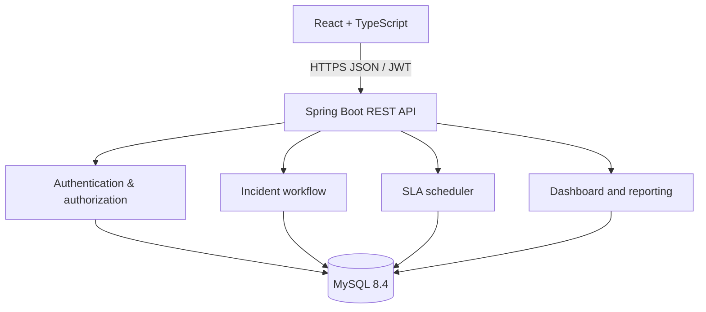

# IncidentIQ architecture

IncidentIQ uses a modular-monolith approach so the application can be understood, tested, and deployed as one API while keeping business capabilities separated by package.

## Backend request flow
1. JWT filter validates the bearer token and loads the active user.
2. Controller parses request data and delegates to a service.
3. Service applies domain rules, validates lifecycle transitions, and writes history entries.
4. Spring Data JPA persists entities in MySQL; Flyway manages schema changes.
5. API DTOs expose only fields required by the client.

## Reliability choices
- Explicit incident state machine rejects invalid transitions.
- Unique incident keys and relational constraints protect data integrity.
- Scheduled SLA checks set breach flags and add a history entry only once.
- Pagination and indexes support incident search.
- JWT secret and database credentials are environment-driven.

## Current scope / honest limitations
The current version uses a scheduled in-process SLA checker and in-app audit history. It does not yet include distributed job coordination, email delivery, business-hours calendars, service dependency mapping, or true live streaming. Those are possible follow-on milestones rather than claims about the current implementation.
