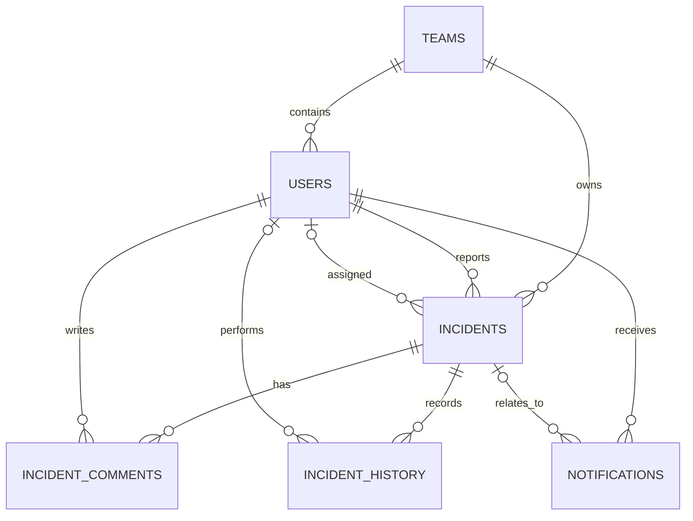

# IncidentIQ entity relationship diagram

Note: the current schema stores SLA deadlines and breach flags directly on `incidents`, while `sla_policies` defines target durations by priority (matched in the service by priority rather than a foreign key). `notifications` is present as a schema foundation; a delivery worker is a future enhancement.
